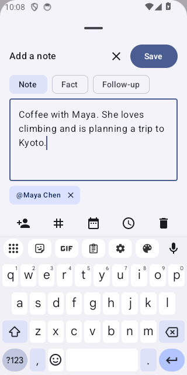
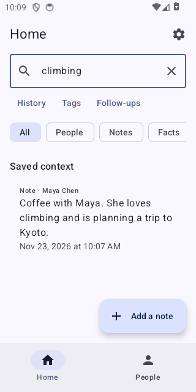
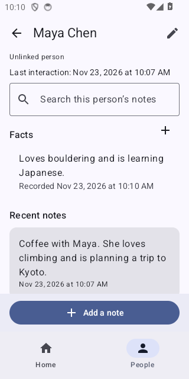

# Personal CRM

Remember the little things about the people in your life.

Save a quick note after a conversation. Find it later by searching for a detail, even when you've forgotten the name.

**In development.** No public download yet. Requires Android 7.0 or later.

  
  
  

- **Capture quickly.** Save conversations and personal details, or share text from another app.
- **Find what you remember.** Search a name, an interest, or a few words from a conversation.
- **Follow up on your terms.** Choose what to follow up on, with optional reminders.

No account needed. Your notes stay on your device, with backups to a folder you choose. Add people by name or import your Android contacts.

## Learn more

[Using the app](docs/using-the-app.md) · [Development](docs/development.md)

Free and open source under [GPL-3.0-or-later](LICENSE). This project will remain free to use, without monetization. [License details](docs/licensing.md).
